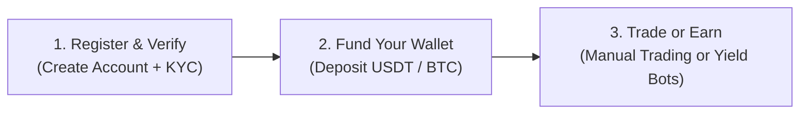
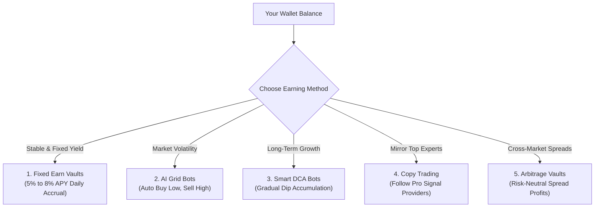

# 📘 HKFES Platform — Client User Guide
### *Everything You Need to Know About How the App Works and How You Earn*

---

## 🌟 Welcome to HKFES

**HKFES** is an institutional-grade, multi-asset trading and automated earning platform designed to provide a fast, secure, and intuitive financial experience. 

Whether you want to trade live global markets manually or generate passive returns through automated bots and fixed-yield vaults, HKFES gives you all the tools in one unified app.

### 🌐 What Markets Can You Trade?
* **🪙 Cryptocurrencies**: Bitcoin (BTC), Ethereum (ETH), Solana (SOL), Ripple (XRP), BNB, and more.
* **💱 Foreign Exchange (Forex)**: EUR/USD, GBP/USD, USD/JPY, AUD/USD, USD/CAD, etc.
* **📈 Global Equities & Tech Stocks**: Apple (AAPL), Nvidia (NVDA), Microsoft (MSFT), Tesla (TSLA), Amazon (AMZN).
* **🥇 Precious Metals & Energy**: Gold (XAU/USD), Silver (XAG/USD), Crude Oil (WTI & Brent), Natural Gas.
* **📊 Major Indices**: S&P 500 (SPX500), Nasdaq 100 (NAS100), Dow Jones (US30), DAX 40 (GER40).

---

## 🚀 Quick Start: 3 Easy Steps

### 1. Create Your Account & Log In
1. Visit the app and click **Get Started** or **Sign Up**.
2. Enter your Email and create a strong password.
3. For added security, enable **Two-Factor Authentication (2FA / Google Authenticator)** in your **Settings** to protect your capital.

### 2. Verify Your Identity (KYC)
To comply with financial safety standards and unlock full platform capabilities:
* Go to your **Profile / KYC Verification**.
* Fill in your legal name and residential address.
* Upload a valid photo ID (Passport, National Identity Card, or Driver’s License).
* Verification is reviewed swiftly by the compliance desk.

### 3. Install as a Mobile App (PWA)
You don’t need an app store! HKFES is a high-speed Progressive Web App (PWA):
* **On iPhone (iOS)**: Open Safari, tap the **Share** button (box with an arrow pointing up), and select **"Add to Home Screen"**.
* **On Android**: Open Chrome, tap the **three dots menu (⋮)**, and select **"Install App"** or **"Add to Home Screen"**.
* **On Desktop (Mac/PC)**: Click the **Install** icon on the right side of your browser address bar.

---

## 💼 Wallet Basics: Understanding Your Balances

Your **Wallet** (`/wallet`) displays your funds in clear categories so you always know where your money is:

| Balance Type | Meaning |
| :--- | :--- |
| **Total Balance** | The total gross value of your account (Cash + Active Investments + Profits). |
| **Available Balance** | Liquid cash ready to be withdrawn, placed into new trades, or subscribed to bots. |
| **Reserved for Trading** | Funds currently backing active open positions and margin. |
| **Reserved for Earn / Bots** | Capital actively deployed in yield vaults, grid bots, or copy trading. |

---

## 💳 How to Deposit and Withdraw Funds

### 📥 Depositing Funds
1. Navigate to **Wallet** → **Deposit**.
2. Select your preferred asset: **USDT (Tether)** or **BTC (Bitcoin)**.
3. Choose your deposit network:
   * **USDT (TRC20)**: *Recommended* — Fastest confirmation (10–25 mins) and lowest gas fees.
   * **USDT (BEP20 / BSC)**: Very low network fees.
   * **USDT (ERC20)**: Ethereum mainnet (high security for large volumes).
   * **BTC (Native SegWit)**: Direct Bitcoin blockchain deposit.
4. Copy the platform deposit address or scan the **QR Code** using your crypto wallet (e.g., Binance, Bybit, Trust Wallet, OKX).
5. After sending, click **"I Have Sent the Funds"**, enter the amount, and submit the Transaction Hash (TxID) or payment receipt.
6. Once verified on the blockchain, your balance is automatically credited.

### 📤 Withdrawing Funds
1. Navigate to **Wallet** → **Withdraw**.
2. Select your payout asset (**USDT** or **BTC**) and network.
3. Paste your personal destination wallet address.
   > ⚠️ **Important Check**: Always ensure your receiving wallet matches the selected network (e.g., TRC20 addresses start with **T**; ERC20/BEP20 addresses start with **0x**).
4. Enter the withdrawal amount and confirm with your security 2FA code.
5. Withdrawals are processed safely within the designated SLA (typically 1–2 hours).

---

## 📈 How Manual Trading Works

If you want to actively trade the markets yourself:

1. Click on **Trade** (`/trade`) from the navigation bar.
2. **Select Asset**: Choose any currency, crypto, commodity, or stock from the asset selector.
3. **Analyze the Chart**: Use the interactive Candlestick chart to review real-time prices, highs, and lows.
4. **Choose Your Order Type**:
   * **Market Order**: Executes immediately at the current live market price.
   * **Limit Order**: Executes automatically only when the market hits your designated target price.
   * **Stop Order**: Executes once a market breakout price is triggered.
5. **Set Direction**:
   * **Buy (Long)**: If you believe the asset’s price will go up.
   * **Sell (Short)**: If you believe the asset’s price will go down.
6. **Apply Risk Protection (Crucial!)**:
   * **Take Profit (TP)**: Automatically locks in your profits when the price reaches your target.
   * **Stop Loss (SL)**: Automatically caps your risk if the market moves against you.
7. **Manage Positions**: Track your live Profit & Loss (P&L) under **Open Positions**. You can close positions anytime with one click.

---

## 💰 How Earning Works: Automated Wealth & Yield

> 📘 **Deep-Dive Guide Available**: For a comprehensive, step-by-step breakdown of calculations, profit formulas, and live examples for each product, see our dedicated [Earning Methods Guide](EARNING_METHODS_GUIDE.md).

For clients who prefer hands-off, passive returns without sitting at charts all day, HKFES offers the **Services & Automated Earning Hub** (`/services`).

You can choose from several verified earning strategies:

---

### 1. Fixed Staking Vaults (Predictable Daily Yield)
* **USD Earn (5% APY — Flexible)**:
  * **How it works**: Deposit idle USD/USDT balance into the vault.
  * **Accrual**: Interest accrues **daily**.
  * **Flexibility**: Unstake and withdraw principal + interest anytime with zero lockup penalty.
  * **Ideal for**: Conservative clients looking for risk-free daily compound growth.
* **High-Yield Vault (8% APY — 30-Day Term)**:
  * **How it works**: Allocate capital for a fixed 30-day period for higher annualized yields.
  * **Ideal for**: Medium-term yield seekers.

### 2. AI Grid Trading Bots (Profit from Fluctuations)
* **Asset**: E.g., BTC/USD or ETH/USD.
* **How it works**: The algorithm builds a multi-level price ladder (grid). Every time price drops a notch, it buys; whenever price bounces up a notch, it sells.
* **Why it earns**: The bot captures small, steady gains 24/7 out of normal sideways market chop without predicting market direction.
* **Return Profile**: Target weekly returns of **+1.5% to +2.5%** during active market volatility.

### 3. Smart DCA Accumulators (Dollar-Cost Averaging)
* **How it works**: Automatically buys fractional positions of high-growth assets (like Ethereum or Solana) at scheduled intervals (e.g., every 6 hours), with smart RSI filters that increase buy size during price dips.
* **Why it earns**: Prevents you from buying at the top and ensures a low average purchase price over time.

### 4. Copy Trading (Mirror Pro Traders)
* **How it works**: Browse verified master traders (e.g., *AlphaTrader*, *CryptoSage*, *SteadyHands*). Inspect their historical win rates, monthly return rates, and risk scores.
* **Earning mechanism**: When the pro trader opens or closes a position, your account automatically duplicates the identical trade in exact proportion to your allocated capital.
* **Risk Controls**: You can set a maximum drawdown stop (e.g., stop copying if loss reaches 10%).

### 5. Automated Arbitrage
* **How it works**: High-frequency algorithms scan price discrepancies across different order books and synthetic market pairs.
* **Why it earns**: Buys on the lower exchange and sells on the higher exchange simultaneously to lock in risk-neutral micro-spreads.

---

## 🛠 Step-by-Step: How to Start Earning Today

1. Go to the **Services** tab in the main navigation.
2. Select the product category you prefer (e.g., **Fixed Staking**, **AI Grid Bots**, or **Copy Trading**).
3. Click on the product card to open the **Service Configurator**.
4. Enter the amount of USD you want to allocate (minimum amounts start as low as $100).
5. Review the expected APY / weekly return estimate and risk level.
6. Click **Confirm & Activate Strategy**.
7. Sit back and watch your daily earnings accumulate in real-time under your **Portfolio** and **Dashboard**! You can pause or stop any bot at any time.

---

## 📊 Summary of Earning Methods

| Product | Risk Level | Target Returns | Best Suited For | Withdrawal Terms |
| :--- | :--- | :--- | :--- | :--- |
| **USD 5% Earn** | Very Low | 5.0% APY | Steady savers & capital preservation | Instant / Anytime |
| **High Yield 8% Vault** | Low | 8.0% APY | Fixed-term yield maximizers | 30-Day Term |
| **AI Grid Bot (BTC)** | Medium | +2.0% / week | Volatile sideways markets | Stop & redeem anytime |
| **Smart DCA Bot (ETH)** | Medium | +1.8% / week | Accumulating assets at optimal prices | Stop & redeem anytime |
| **Copy Trading** | Variable | +3.0% to +5% / month | Hands-off investors following pro traders | Close trades anytime |
| **Arbitrage Strategy** | Low | +0.5% / week | Market-neutral micro returns | Stop & redeem anytime |

---

## 🛡 Security & Best Practices for Clients

* 🔒 **Keep 2FA Enabled**: Protect your account by keeping Google Authenticator or SMS verification active at all times.
* ⚖️ **Diversify**: Don't put 100% of your funds into a single aggressive bot. Keep a portion in stable Earn Vaults (5% APY) and a portion in automated bots.
* 🛑 **Use Stop Losses**: If manual trading, never leave a high-leverage trade open without a protective Stop Loss.
* ⚠️ **Official Links Only**: Always ensure you are on the authentic platform URL. HKFES support will never ask for your password or 2FA backup codes.

---

## ❓ Frequently Asked Questions (FAQ)

#### Q1: When do I receive my earnings?
> **Answer**: For Earn Vaults, interest is calculated and credited to your balance daily. For Grid Bots and Copy Trading, profits are added immediately each time a trade cycle is completed and closed.

#### Q2: Can I cancel a bot or withdraw my funds whenever I want?
> **Answer**: Yes! You maintain full custody and control over your allocations. You can pause or stop any bot with one tap, and your capital is immediately released back to your Available Balance.

#### Q3: How do I contact help if I have questions?
> **Answer**: Open the **Help** (`/help`) page on the navigation menu. You can use our 24/7 **Live Chat** widget or submit a support ticket directly to our Tier-1 institutional trading desk.

---

*Thank you for choosing HKFES. Happy trading and earning!*
