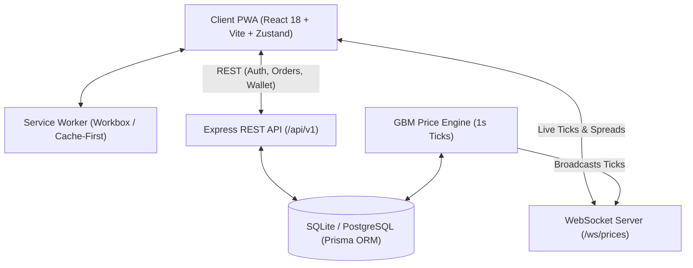

# HKFES — Professional Multi-Asset Trading Platform

[](https://github.com/hkfes/hkfes-platform)
[](LICENSE)
[](https://nodejs.org)
[](https://react.dev)
[](https://www.typescriptlang.org)
[](https://www.prisma.io)

HKFES is an institutional-grade, simulated foreign exchange and multi-asset trading platform delivered as a high-performance **Progressive Web App (PWA)** with real-time WebSocket price streaming and a Geometric Brownian Motion simulation engine.

> 📖 **User Documentation Guides**:
> - [Client User Guide](CLIENT_USER_GUIDE.md) — Comprehensive guide on app onboarding, wallet funding/withdrawing, and platform features.
> - [Earning Methods Guide](EARNING_METHODS_GUIDE.md) — In-depth guide explaining how every yield vault, AI trading bot, and copy trading product generates profit.

---

## 🏛 System Architecture



---

## 🚀 Quickstart

### Prerequisites
- Node.js 20+ LTS
- npm 10+

### Option A: Local Development

1. **Clone & Install Dependencies**:
   ```bash
   git clone <repo-url>
   cd hkfes-app
   cd backend && npm install && npm run prisma:push && npm run seed
   cd ../frontend && npm install
   ```

2. **Start Backend Server**:
   ```bash
   cd backend
   npm start
   # Server live on http://localhost:4000
   # WebSocket live on ws://localhost:4000/ws/prices
   ```

3. **Start Frontend PWA**:
   ```bash
   cd frontend
   npm run dev
   # App live on http://localhost:5173
   ```

### Option B: Docker Compose

```bash
docker compose up --build
```
- Frontend UI: `http://localhost`
- Backend API: `http://localhost:4000`

---

## 🔑 Pre-Seeded Test Accounts

| Persona | Email | Password | Role | Focus / Initial Balance |
|---------|-------|----------|------|-------------------------|
| **Admin Sam** | `admin@hkfes.com` | `AdminPassword123!` | `admin` | Full platform administration, KYC review, balance resets, market volatility spike injector |
| **Trader Alex** | `alex@hkfes.com` | `Password123!` | `user` | Retail FX & Crypto trading ($10,450 paper USD, open positions on EUR/USD & BTC) |
| **Quant Maya** | `maya@hkfes.com` | `Password123!` | `user` | Automated Grid & DCA trading bots ($25,000 balance) |
| **Investor Jordan** | `jordan@hkfes.com` | `Password123!` | `user` | High-yield Earn Vaults & Copy Trading ($12,500 balance) |

---

## 📱 Screen Coverage Map (26 Screens)

| Screen ID | Name | Route | Highlights |
|-----------|------|-------|------------|
| **S01** | Landing Page | `/` | Particle canvas hero, platform features, PWA install prompt |
| **S02** | Onboarding Carousel | `/onboarding` | 3-step value proposition slider |
| **S03** | Sign Up | `/register` | Password strength validation & terms agreement |
| **S04** | Log In | `/login` | Email/password login with MFA TOTP support |
| **S05–S08**| KYC Verification | `/kyc` | Multi-step personal, address & ID document upload simulation |
| **S09** | Dashboard | `/dashboard` | Portfolio value, performance chart, open positions, quick actions |
| **S10** | Trade Terminal | `/trade` | Lightweight Candlestick chart, order book depth, leverage, SL/TP |
| **S11** | Portfolio | `/portfolio` | Asset allocation donut, historical PnL, open & closed trades |
| **S12** | Services Catalog | `/services` | Earn vaults, Grid bots, DCA bots, Copy trading, Arbitrage |
| **S13** | Service Configurator | `/services/:id` | Capital allocation, risk profiling, parameter sliders |
| **S14** | Wallet | `/wallet` | USD paper balance breakdown (cash vs reserved) |
| **S15** | Deposit | `/wallet/deposit` | Simulated Crypto, Card, and Bank Wire deposit flows |
| **S16** | Withdrawal | `/wallet/withdraw` | Address validation, 2FA prompt, instant settlement |
| **S17** | Notifications | `/notifications` | Trade fills, bot alerts, yield accrual notices |
| **S18** | Settings | `/settings` | Profile, password change, 2FA toggle, sessions |
| **S19** | Help & Support | `/help` | Searchable FAQs, contact form, live simulated chat |
| **S20** | Admin Dashboard | `/admin` | System health, volume metrics, total user count |
| **S21–S22**| User Management | `/admin/users` | User list, KYC approvals, balance overrides |
| **S23** | Audit Log | `/admin/audit-logs` | Immutable log of orders, logins, and admin interventions |
| **S24** | Report Builder | `/admin/reports` | Exportable platform analytics (CSV / PDF) |
| **S25** | PWA Install Guide | Modal | Platform-specific iOS Safari & Android Chrome instructions |
| **S26** | Offline Fallback | `/offline` | Custom offline state with auto-reconnect polling |

---

## 📡 REST & WebSocket API Specification

### Base URL: `http://localhost:4000/api/v1`

- `POST /auth/register` — Create simulated user account
- `POST /auth/login` — Authenticate and receive JWT
- `GET /market/assets` — Master list of assets with live prices & 24h change
- `GET /market/assets/:symbol/candles` — OHLCV candlestick data
- `GET /market/assets/:symbol/orderbook` — Simulated order book depth
- `POST /trading/orders` — Place market, limit, or stop order
- `GET /trading/positions` — Active positions with unrealized P&L
- `POST /trading/positions/:id/close` — Close open position
- `GET /portfolio/summary` — Portfolio valuation and today's PnL
- `GET /wallet` — Simulated USD balances
- `POST /wallet/deposit` — Simulate account funding
- `POST /wallet/withdraw` — Simulate account withdrawal
- `GET /services` — Catalog of algorithmic trading strategies
- `POST /services/:id/subscribe` — Allocate capital to a bot or vault
- `GET /admin/stats` — Platform metrics (Admin only)
- `POST /admin/engine/spike` — Inject simulated volatility spike (Admin only)

### WebSocket: `ws://localhost:4000/ws/prices`
- On connection: sends full snapshot of all asset prices
- Every 1s: broadcasts updated ticks `{ type: 'tick', data: [...] }`
